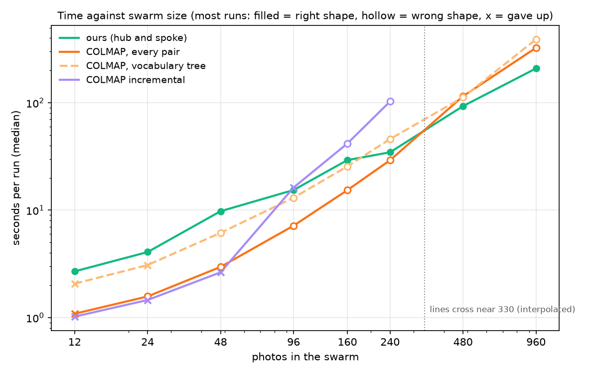

# shape_from_views

Reconstruct an object's shape from posed photos and their silhouette masks (a *visual hull*), and
write it out as a COLMAP `sparse/0` folder. NeRF and 3D Gaussian Splatting code can then start from
it instead of running COLMAP.

This is the readable Python version of [sfm_demo_2.0](https://github.com/kevdozer1/sfm_demo_2.0),
which is written in C++. Both implement the same algorithm with the same options and defaults, and
on the same inputs they keep exactly the same voxels.

```
photos + masks ──► estimate ──► state estimates (distance + attitude per photo) ──► camera poses ─┐
                                                                  images + masks ───────────────┴─► visual hull
```

The state estimates can be hard-coded (your own lists, or `orbit --write-states`) or measured from
the photos themselves with `estimate` (below).

## Quick start

```bash
pip install -r requirements.txt          # numpy + pillow (pytest for the tests)

# 1. camera poses: either from state lists ...
#    (the demo lists are sfm_demo_2.0/examples/anduril/distances.txt and attitudes.txt; for any
#    ring orbit, `orbit DATASET --write-states DIR` writes matching lists)
python shape_from_views.py poses data/anduril distances.txt attitudes.txt --baseline 0 -21.8014 0
#    ... or for cameras that circle the object on rings (radius,height per ring)
python shape_from_views.py orbit data/anduril --rings "10,-4;12,0;10,4"

# 2. the visual hull (writes data/anduril/visual_hull.ply and sparse/0/points3D.bin + .ply)
python shape_from_views.py hull --data data/anduril
```

A dataset folder looks like this (the layout NeRF/3DGS code expects):

```
data/anduril/
├── images/      0001.jpg ...  the photos; orbit/poses take the frame list and image size from them,
│                              hull only uses them for colour
├── masks/       0001.jpg ...  white = object, black = background (same names, or .png)
└── sparse/0/    cameras.bin, images.bin, points3D.bin   (COLMAP format)
```

No data? The test helper renders a toy plane into a dataset folder:

```bash
python -c "import pathlib, test_shape_from_views as t; t.make_dataset(pathlib.Path('toy'))"
python shape_from_views.py hull --data toy
```

The hull run ends with a sanity check:

```
silhouette coverage: mean 1.000, min 0.999 (0194.jpg)
```

Coverage is the fraction of each mask that the finished hull covers when projected back into that
view. If every pose and mask is right it is about 1.0 everywhere. A wrong pose or a mismatched mask
carves away parts that the other views need, and the affected views are listed by name. Look at
this number before you look at the point cloud.

## Measuring the states from the photos (`estimate`)

Every camera looks at the same target, so seen from the target a camera is fully described by two
quantities per photo: its **attitude** (how the target looks turned, relative to photo 1: yaw,
pitch and roll) and its **distance** (as a multiple of photo 1's), 4 numbers in all. Photo 1 is the
origin: yaw, pitch and roll 0. Its attitude only turns the whole scene and its distance only scales
it, so neither changes the shape. `estimate` measures both for every photo, from the photos alone:

```bash
pip install -r requirements-estimate.txt      # PyTorch with CUDA, LightGlue, numba, OpenCV, scipy
python shape_from_views.py estimate data/anduril --out states
python shape_from_views.py poses data/anduril states/distances.txt states/attitudes.txt \
       --baseline 0 0 0 --photos states/photos.txt --out est
python shape_from_views.py hull --data data/anduril --sparse est/sparse/0
```

`estimate` writes the usual `distances.txt` and `attitudes.txt`, plus `photos.txt` with the photo
of each row (a photo it cannot place is left out, and the reason is printed). It needs the photos,
the masks and the lens, nothing else:

* **No order.** It never uses the order of the photos, so a swarm of observers at random vantage
  points works as well as one camera on an orbit. `--origin PHOTO` picks photo 1.
* **No background.** Only the target's pixels are used: the background is empty sky or moves on its
  own in real use, and the target is the one thing all the photos share.
* **The camera points at the target.** Each photo's centre is the target's centre (the hub), as a
  tracker keeps it. That is what makes 4 numbers per photo enough (COLMAP solves 6).

How it works (`estimate.py`, read top to bottom; each stage is timed):

1. **features**: SuperPoint keypoints on the target only (inside the mask). The networks are not
   rotation-invariant and observers roll, so small swarms also describe every crop turned by ±40°.
2. **matching**: LightGlue on the GPU, every pair for up to 64 photos, else each photo's most similar
   ones.
3. **two views**: a matched pair gives the turn between its two cameras and their distance ratio.
   Because both cameras look at the hub, that is 4 unknowns (COLMAP solves 5). The silhouettes pin
   the one direction the matches leave loose: the outer epipolar tangents of the two outlines must
   correspond.
4. **all views**: rotation averaging over the verified pairs, robust to wrong ones (the aircraft's
   left side matches its identical right side), and the distances from the ratios. Groups of photos
   with no link between them are kept as rigid units and attached later as a whole.
5. **bundle adjustment** with 4 unknowns per camera (the state model itself) and the 3-D points,
   plus the silhouette tangency of camera pairs.
6. **growth**: photos with no feature link are placed by resection, or by fitting their silhouette
   to the visual hull of the others; a silhouette-only placement is compared with its mirror twin.
7. **checks**: every camera must agree with the others' silhouettes and must not carve away what they
   see. The result names every photo it could not place, and why.

### How well, and how fast

Measured on renders of an aircraft whose true cameras are known (240 observers at random directions,
distances and rolls, and a 360-photo orbit), on swarms drawn after the code was finished. One
machine: RTX 3080, 8 CPU threads, the networks loaded. Each row is the median of three random swarms
(one for 240 photos and for the orbit). The errors are against the true cameras, relative to
photo 1. The hull IoU compares the hull carved with the estimated cameras with the hull carved with
the true cameras of the same photos (1 = the same voxels; photo 1's own small error turns the whole
estimate and counts against it here).

| photos | placed | attitude error | distance error | hull IoU | time |
|---|---|---|---|---|---|
| 12 random observers (x3) | 36/36 | 0.28° | 0.11 % | 0.977 | 3.3 s |
| 24 random observers (x3) | 71/72 | 0.27° | 0.10 % | 0.977 | 5.6 s |
| 48 random observers (x3) | 144/144 | 0.12° | 0.06 % | 0.988 | 8.6 s |
| 96 random observers (x3) | 287/288 | 0.17° | 0.08 % | 0.984 | 15.4 s |
| all 240 observers | 239/240 | 0.12° | 0.05 % | 0.992 | 34.3 s |
| the 360-photo orbit, shuffled | 360/360 | 0.06° | 0.05 % | 0.996 | 54.4 s |

Where the time goes, for 48 photos: features 1.5 s, matching 4.3 s, two-view geometry 0.7 s, mapping
0.9 s, bundle adjustment 0.8 s. The rest of the loop is quick: the state lists and `poses` take
about 0.3 s, the C++ carve 0.5 to 2 s. A fresh process needs about 6 s more to load PyTorch and the
networks (the swarm GUI keeps them loaded), and numba compiles its kernels once after `estimate.py`
changes (about 15 s).

On 33 more random swarms (12 to 96 observers, seeds 900 to 932, run with the final code), 30 were
good: photo 1 placed, at least 90 % of the photos placed, a hull IoU of at least 0.97 after removing
photo 1's own turn, and silhouette coverage of at least 0.99. By size: 12 observers 8 of 10, 24
observers 15 of 15, 48 observers 5 of 5, 96 observers 2 of 3. Two of the misses are 12-observer
swarms where only 9 and 6 photos were placed; the third placed all 96 photos (IoU 0.994) but one
silhouette is covered only to 0.979. Small swarms fail when some observers have no neighbour within
about 40-50°: there is nothing to match.

#### Against COLMAP

COLMAP 4.2.1 (the CUDA build) on the same swarms and machine: the same photos with the background
painted out, the same fixed lens, SIFT and matching of every pair on the GPU, then its global or its
incremental mapper. "Placed" counts the photos in photo 1's model (a photo in a separate model has no
attitude relative to photo 1). The IoU is the median over the swarms where at least 3 photos were
placed, the time the median wall time.

| photos | ours | COLMAP global | COLMAP incremental |
|---|---|---|---|
| 12 random observers (x3) | 36/36, IoU 0.977, 3.3 s | 3/36, IoU 0.49 (1 of 3), 1.1 s | 0/36, 1.0 s |
| 24 random observers (x3) | 71/72, IoU 0.977, 5.6 s | 50/72, IoU 0.16, 1.7 s | 3/72, IoU 0.98 (1 of 3), 1.6 s |
| 48 random observers (x3) | 144/144, IoU 0.988, 8.6 s | 76/144, IoU 0.20 (2 of 3), 3.0 s | 17/144, IoU 0.56 (1 of 3), 3.6 s |
| 96 random observers (x3) | 287/288, IoU 0.984, 15.4 s | 265/288, IoU 0.08, 7.4 s | 67/288, IoU 0.51 (1 of 3), 11.0 s |
| all 240 observers | 239/240, IoU 0.992, 34.3 s | 234/240, IoU 0.07, 33.8 s | 0/240, 79.6 s |
| the 360-photo orbit, shuffled | 360/360, IoU 0.996, 54.4 s | 360/360, IoU 0.30, 122.3 s | not run |

COLMAP's global mapper is 2 to 3.3 times faster up to 96 photos, as fast at 240 photos, and takes
twice as long on the 360-photo orbit. But on these swarms it places few photos, or builds bent
models: the aircraft looks the same from the left and from the right (it carries the same decals on
both sides), so some pairs matched across the two sides pass COLMAP's checks, and those false links
bend the model. `estimate` rejects them (two-view checks and robust rotation averaging) and places
the observers with too few matches from their silhouettes. The incremental mapper's IoU of 0.98 at
24 photos is a hull from 3 cameras.

#### How the time grows with the swarm

Denser swarms, drawn from 960 renders (the 240 above plus 720 more from the same script): three new
random swarms per size up to 240 (seeds 1001 to 1003), one at 480 and all 960. COLMAP also ran with
its vocabulary-tree matcher, its own recipe for large photo sets, with its default tree. Same
machine, networks loaded, 8 CPU threads each (COLMAP's vocabulary-tree search used all 24); "right"
means a hull IoU of at least 0.95 with at least 90 % placed, "gave up" fewer than 3 photos placed
with photo 1.



| photos | ours | COLMAP, every pair | COLMAP, vocabulary tree | COLMAP incremental |
|---|---|---|---|---|
| 12 | 2.7 s, 3 of 3 right | 1.1 s, 0 of 3 (2 gave up) | 2.1 s, 0 of 3 (3 gave up) | 1.0 s, 0 of 3 (3 gave up) |
| 48 | 9.8 s, 3 of 3 right | 3.0 s, 0 of 3 | 6.2 s, 0 of 3 | 2.6 s, 0 of 3 (3 gave up) |
| 96 | 15.4 s, 3 of 3 right | 7.2 s, 0 of 3 (1 gave up) | 13.1 s, 0 of 3 (1 gave up) | 16.2 s, 0 of 3 (3 gave up) |
| 240 | 34.6 s, 3 of 3 right | 29.2 s, 0 of 3 | 46.0 s, 0 of 3 | 103 s, 0 of 3 |
| 480 | 93.1 s, right | 115 s, wrong | 113 s, wrong | not run |
| 960 | 209 s, right | 325 s, wrong | 390 s, wrong | not run |

The lines cross near 330 photos, by interpolation: nothing ran between 240 and 480, the two largest
sizes are single swarms, and on one of the three 240-photo swarms `estimate` was already the faster.
Below that COLMAP finishes sooner, often by giving up, while `estimate` matches every pair with
LightGlue up to 64 photos (about 8 times COLMAP's cost per pair) and describes each photo at three
rolls up to 40 photos.

Matching every pair is what grows for COLMAP: at 960 photos it spent 196 of its 325 s matching
460,320 pairs. Beyond 64 photos `estimate` matches each photo with its 12 most similar and photo 1
with every photo, then, while mapping, the pairs its estimate says overlap: 12,914 pairs at 960
photos (91 s of its 209 s, with the two-view checks). The vocabulary tree cut COLMAP's matching to
120 s, but its global mapper then took 241 s. From 96 to 960 photos the time of `estimate` grew
14-fold, COLMAP's 30-fold (vocabulary tree) and 45-fold (every pair). At this size mapping decides
the race, and COLMAP's mappers ran on the CPU (this build's bundle adjustment has no GPU support):
outside mapping, its vocabulary-tree run took 149 s. A build with GPU bundle adjustment was not
tried.

No COLMAP run gave the right shape. 22 of its 58 runs gave up, and 18 placed 8 % to just under 90 %
of the photos (the four with a hull IoU above 0.9 are hulls from 3 or 4 cameras). The 18 that placed
90 % or more had a hull IoU of 0.02 to 0.48, and their models are bent rather than mirrored: even
after the best single rotation onto the truth, 16 of them kept over half their cameras more than 10°
off. A hull keeps only what every photo agrees on, so a few bad cameras carve most of it away: the
vocabulary-tree run on all 960 placed 948 of its 956 cameras within 10° (median 0.5°) and still had
an IoU of 0.18; carved without the other 8 it would have been 0.87.

**A 3-D model, not just poses.** COLMAP's route to a model continues with dense stereo (PatchMatch
on every photo, then fusion). Given the true poses, so that pose errors could not spoil it, its
defaults (full frames, up to 20 neighbouring photos each, on the GPU) took 7.1 min for 12 photos,
17.7 min for 24 and 36.1 min for 48, 36 to 45 s per photo. The aircraft fills a median of 8 % of
each frame, so cropping would cut that, though likely not to seconds. For the same swarms `poses`
and the C++ carve take 0.7 to 2.1 s, so `estimate` + carve gives a model of 48 photos in about 12 s.
The two are not the same product: dense stereo recovers hollows and fine relief that a silhouette
hull cannot.

## Conventions

Most of what went wrong in the original project was a convention mismatch, so here they are:

| what | convention |
|---|---|
| pose | world-to-camera: `X_cam = R @ X_world + t`; camera centre `C = -R.T @ t` |
| camera axes | **x right, y DOWN, z forward** (COLMAP / OpenCV), not OpenGL/Blender's y-up, z-backward |
| quaternion | `(qw, qx, qy, qz)` of R, as in COLMAP files |
| pixels | pixel (i, j) covers [i, i+1) x [j, j+1); a point at (u, v) lands in pixel (floor u, floor v) |
| generated poses | world +Z up, object at the origin, yaw 0 = camera on the -Y axis |
| `distances.txt` | one number per line: camera-to-object distance (> 0) |
| `attitudes.txt` | `d_yaw d_pitch d_roll` per line in degrees, *differences from frame 0*; absolute = `--baseline` + difference |

Yaw and pitch say where the camera sits around the object (azimuth and elevation), so the object's
apparent yaw has the opposite sign. Roll spins the camera about its own viewing direction, and a
generated camera always looks at the origin. Line k of the lists belongs to the k-th image in name
order. If you leave out `--baseline`, frame 0 is assumed to sit at yaw 0, pitch 0 (level with the
object) and roll 0. For the demo orbit the correct baseline is pitch -21.8014.

## How the visual hull works (`visual_hull.py`)

A point can be part of the object only if every view that can see it sees it on the silhouette.
The steps:

1. **Find where to look** (`look_at_point`, `initial_box`). The point closest to every camera's
   viewing axis is where the object is. The starting cube around it is as large as the cameras can
   see.
2. **Fill it with voxels** (`make_grid`): cubic voxels, `--voxel-num` along the longest side.
3. **Carve** (`carve`). Each view puts every voxel in one of three groups:
   * *hit*: the voxel's footprint touches the silhouette;
   * *miss*: the footprint is fully inside the image and only covers background, so the view
     *sees* empty space there;
   * *unseen*: anything else (behind the camera, off the image, or partly off it without touching
     the silhouette), so this view knows nothing.

   A voxel survives with at most `--max-misses` misses (default 0) and at least `--min-votes` hits.
   The default for `--min-votes` is 90% of the views, rounded up, so it is every view below 10
   views. A part of the object that leaves the frame in more views than that allows is still
   carved. Lower `--min-votes` then; the coverage report suggests a value when masks touch the
   image border.

   The footprint (`footprints`) is a rectangle around the voxel's projected centre, `(u, v) +- f*r/z`,
   where r is the radius of the voxel's bounding sphere. For lenses up to about 70 degrees of
   horizontal field of view it contains the whole voxel, so a thin part such as a wing seen edge-on
   is not carved by mistake. Whether a footprint touches the silhouette takes four lookups in a
   summed-area table (`summed_area_table`).
4. **Two passes**. Pass A uses a coarse grid over the big cube to find the object. Pass B uses a
   fine grid (`--passB-res`) over pass A's bounding box.
5. **Output**. Surface voxels only (`--solid` keeps the inside too), outward normals from the
   occupancy gradient, and colours averaged over the views that face each point. The PLY uses
   exactly the layout Inria's 3DGS loader reads: `x y z nx ny nz red green blue`.
6. **Check** (`silhouette_coverage`): the coverage report above.

## All tools

| command | does |
|---|---|
| `orbit DATASET [focal_mm sensor_mm] [--rings R,Z;...] [--out DIR] [--write-states DIR]` | poses for cameras on rings around the object; images are split evenly over the rings |
| `estimate DATASET [focal_mm sensor_mm] [--out DIR] [--origin PHOTO] [--distance D]` | state lists measured from the photos (photo 1 = the origin) |
| `poses DATASET distances.txt attitudes.txt [focal_mm sensor_mm] [--baseline Y P R] [--photos LIST] [--out DIR]` | poses from state estimates (`--photos`: the rows belong to these photos) |
| `hull --data DATASET [--voxel-num 64] [--passB-res 200] [--min-votes N] [--max-misses N] [--solid] [--no-color] [--out-ply PATH] [--no-export] ...` | the visual hull |
| `subset DATASET (--random N [--seed 42] \| --every N) [--out DIR]` | copy some images + masks with a matching `sparse/0` |
| `to-txt SPARSE_DIR` | binary COLMAP model to text |
| `transplant TARGET_SPARSE SOURCE_SPARSE [--by-index]` | copy poses and their intrinsics from another model, matched by image name |

Generated cameras get `f = focal_mm / sensor_mm * max(width, height)` pixels, which is Blender's
default "sensor fit: auto", with the principal point at the image centre.

## Reading the code

| file | lines | what |
|---|---|---|
| `poses.py` | ~140 | quaternions, the look-at camera, poses from states, ring orbits |
| `colmap.py` | ~300 | COLMAP `.bin` / `.txt` reading and writing, camera models and projection |
| `visual_hull.py` | ~430 | the algorithm above, the PLY writer and the export to `sparse/0` |
| `shape_from_views.py` | ~370 | the command line |
| `estimate.py` | ~2200 | the states from the photos, in 9 numbered sections (read top to bottom) |
| `test_shape_from_views.py` | ~310 | tests |
| `test_estimate.py` | ~90 | the estimator's geometry on synthetic cameras (skipped without its packages) |

Start with `visual_hull.visual_hull()` and follow the calls. Some arithmetic (`to_camera`,
`look_at_point`, the dot products) is written out term by term instead of using `@` or
`np.linalg.solve`, so it rounds exactly like the C++ version.

## Tests

```bash
python -m pytest -q
```

The unit tests cover the camera axes, quaternions, the OpenCV projection, COLMAP `.bin` / `.txt`
round trips, state replay, the subset shuffle (it matches the C++ pick), mask thresholds and bad
arguments.

The end-to-end tests ray-trace a toy plane (ellipsoid fuselage, thin wings, a tail fin) from 36
cameras, write a real dataset folder and run the command line on it. They check that:

* the hull contains the object;
* the hull is at most 2.5x the object's volume;
* every view's coverage is about 1;
* the old 180-degree-rolled camera convention is caught by the coverage check;
* parts that leave the frame in a few views survive;
* the colours come from the right parts (the wings come out blue);
* the generators reproduce the cameras the images were rendered with.

Limits worth knowing:

* A silhouette cannot see concavities, so the inside of a cup stays filled.
* A part thinner than about one pixel in some mask is not in the data at all.
